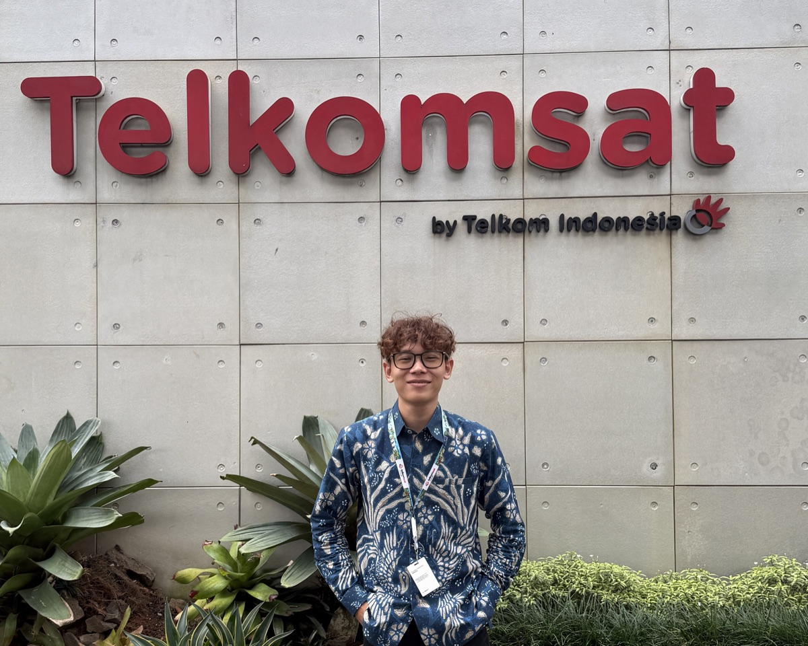

# Hi, I'm Zacky Maulana

Data Scientist | Machine Learning | Computer Vision   
Surabaya, Indonesia  
Universitas Muhammadiyah Surabaya — Informatika (2024–2028)  
Distinction in Coding Camp 2026 powered by DBS Foundation 2026

---

## About Me

I'm a Data Scientist who loves turning raw data into meaningful insights and building AI-powered solutions that solve real problems. Currently focused on machine learning, deep learning, and deploying models to production.

- Currently working on **ModalIn** — AI Credit Scoring platform for Indonesian
- Learning **Deep Reinforcement Learning** and **Agentic AI**
- Interested in **Fintech AI**, **NLP**, and **Computer Vision**
- Reach me at: bossrete@gmail.com

---

## Tech Stack

**Languages**  

**Machine Learning & Data**  

**Computer Vision**  

**Tools & Platforms**  

---

## Experience

### Computer Vision Intern — Telkomsat, Bogor
*Internship · 2 months*

**Mining Truck Detection**
- Melatih model **YOLOv9** untuk mendeteksi truk tambang, status muatan (bermuatan / kosong), excavator, dan bak yang sedang menumpahkan muatan dari kamera CCTV
- mAP50 **0,85–0,94** per kelas pada data uji dari site asli dan tambang lain
- Model diekspor ke **ONNX** (~2 ms per gambar di Mac M1 Pro) dan dijalankan di Frigate NVR sebagai detektor kustom

**SH17 — Deteksi APD (Alat Pelindung Diri)**
- Menambahkan **6 kelas "tidak memakai APD"** (misalnya kepala tanpa helm) ke dataset SH17: 8.099 gambar, dari 17 menjadi 23 kelas
- Kotak label dibuat otomatis dari anotasi yang sudah ada, lalu divalidasi dan dicek manual
- Seluruh 8.099 gambar dinilai konteksnya satu per satu supaya kelas negatif hanya diberikan untuk pekerja lapangan

  

---

## Featured Projects

### [ModalIn - AI Credit Scoring for UMKM](https://github.com/ZackyMaulana912/modalin-app)
> Full-stack AI platform untuk penilaian kredit alternatif UMKM Indonesia

- Neural Network (Keras) menghasilkan skor kredit **100–900** berbasis framework **4C**
- Deteksi **7 jenis anomali arus kas** secara real-time
- Arsitektur microservice: React + Express.js + FastAPI + Streamlit
- Live: [[https://modalin.engineering-umsura.id](https://modalin.engineering-umsura.id)])

### [Smart Rice Detector](https://github.com/ZackyMaulana912/SAFE-GRAIN-BERAS)
> Sistem AI Computer Vision untuk menilai kualitas beras dari foto (proyek tim, Tugas Besar Kecerdasan Buatan)

- Model **YOLOv8** dilatih pada dataset beras lokal untuk mendeteksi **3 kelas**: butir utuh, butir pecah, dan benda asing
- Grading otomatis **Premium / Medium / Low / Tidak Bersih** berdasarkan persentase butir utuh dan jumlah benda asing
- Model disajikan lewat API FastAPI, bisa scan dari upload foto atau kamera langsung

---

## Achievements

- Distinction in Coding Camp 2026 powered by DBS Foundation — Data Scientist

---

  <i>"Data is the new oil, but insight is the refined fuel."</i>

